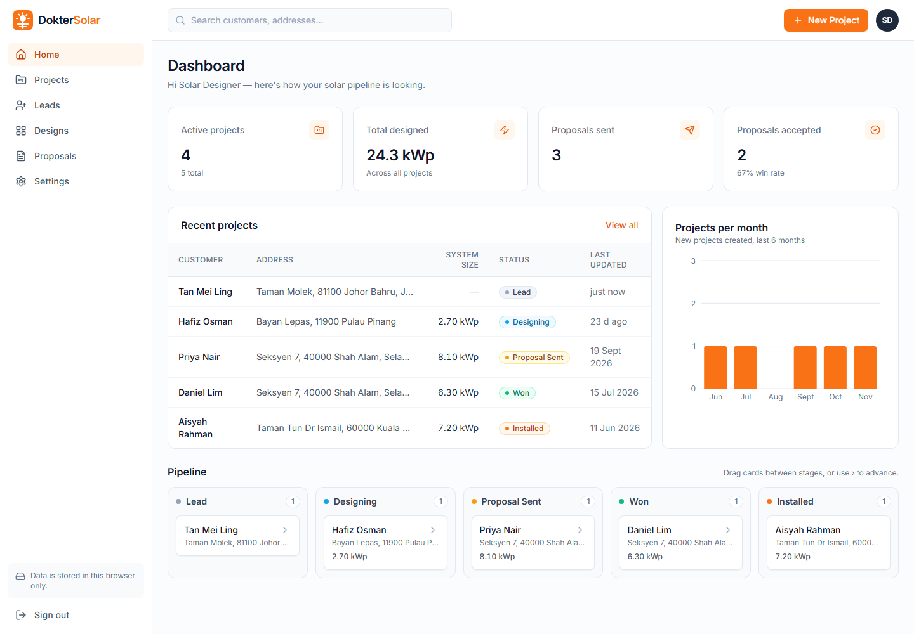
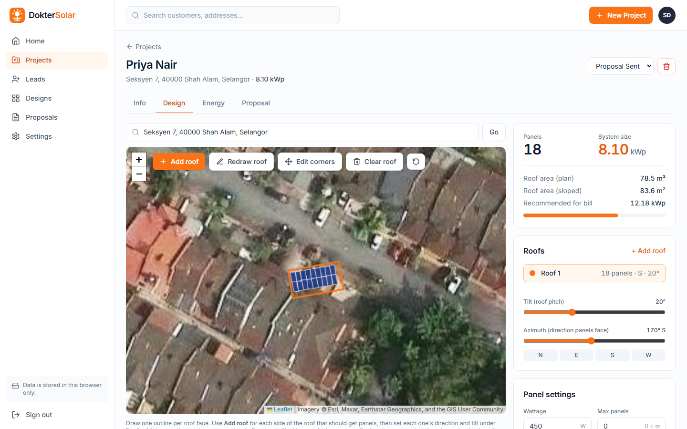
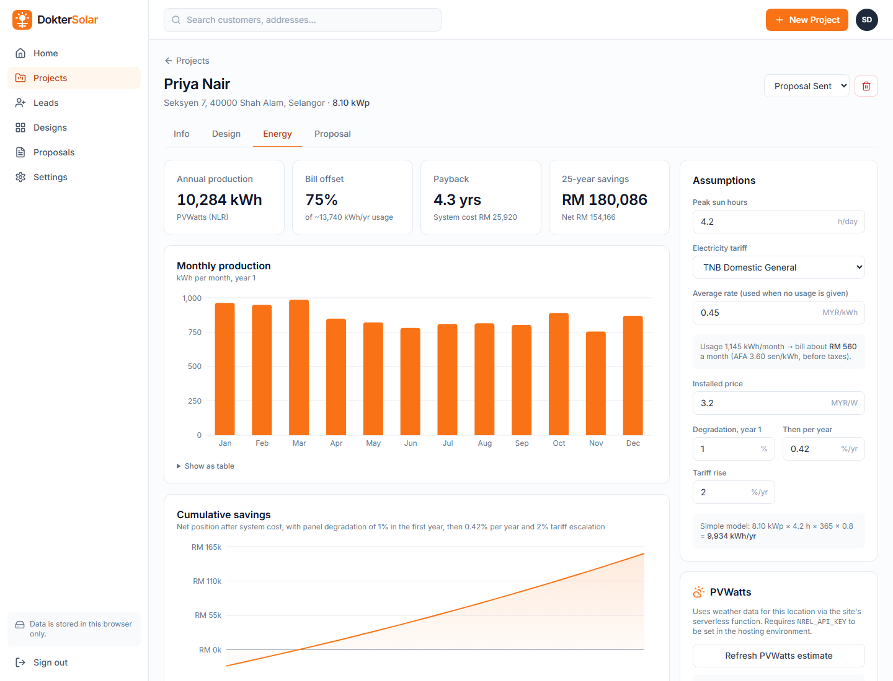
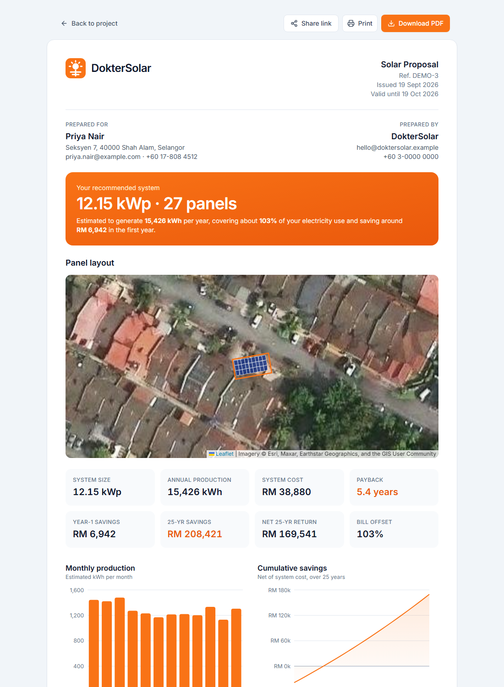
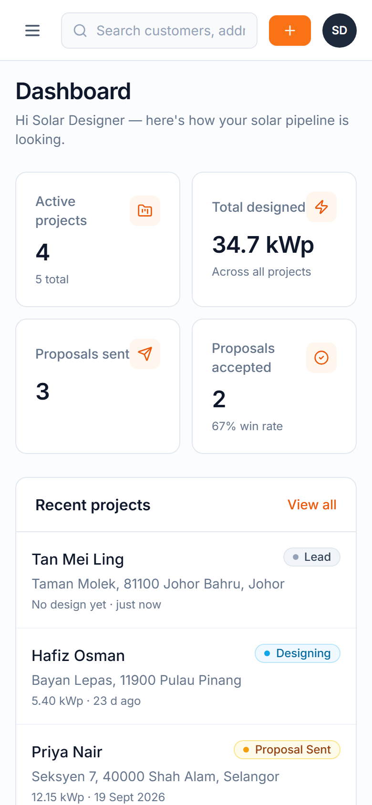

# DokterSolar ☀️

A solar design and proposal studio: sketch a roof on satellite imagery, auto-fill it with panels, estimate energy and savings, and send a printable customer proposal.

[](https://github.com/norazamkamisan/doktersolar/actions/workflows/build.yml)

**🔗 Live demo: [doktersolar.vercel.app](https://doktersolar.vercel.app)** (password-protected; see [Password protection](#password-protection))

> Portfolio project. All names, branding, copy and UI are original.



## Screenshots

**Design tool**: draw the roof on satellite imagery and panels fill it automatically. Panel count and system size update live as you change the settings.



**Energy & savings**: monthly production, payback, 25-year savings and editable assumptions. Shown here with real weather-based figures from PVWatts (NLR) for Shah Alam.



<table>
  <tr>
    <td width="70%" valign="top">
      <strong>Customer proposal</strong>: printable and shareable, with a map snapshot, key numbers and charts.<br><br>
      
    </td>
    <td width="30%" valign="top">
      <strong>Mobile</strong>: fully responsive.<br><br>
      
    </td>
  </tr>
</table>

**Stack:** React 18 · Vite · TypeScript · Tailwind CSS · React Router · Leaflet (react-leaflet) with Esri World Imagery · Recharts · localStorage, synced to a JSON file in Google Drive · Vercel (+ an optional serverless function for NREL PVWatts). Netlify config is included too.

---

## Features

| Area | What it does |
| --- | --- |
| **Dashboard** (`/home`) | Stat cards (active projects, kWp designed, proposals sent/accepted), recent projects, projects-per-month chart, drag-and-drop pipeline (Lead → Designing → Proposal Sent → Won → Installed) |
| **Projects** (`/projects`, `/projects/:id/:tab`) | Create projects (address geocoded with Nominatim), search/filter, tabs for Info, Design, Energy, Proposal |
| **Design tool** | Satellite map, click to draw the roof polygon (double-click or **Finish** to close), drag corners to edit, panels auto-filled in a grid with edge setback and gap. **Add roof** draws more roof faces, each with its own tilt and azimuth (e.g. a south and a north side); click an outline to select it. Wattage, size, orientation and max panels apply to all roofs, with a live panel count and kWp |
| **Energy & savings** | `kWp × peak sun hours × 365 × 0.8`, or NREL PVWatts if configured. Monthly production chart, tariff, price per watt, degradation (first year, then per year), tariff escalation, payback and 25-year cumulative savings |
| **Proposal** (`/proposals/:id`) | A4 pages in the style of a company proposal: cover letter, about us, recommended system with map and equipment, system performance and environmental benefits, how solar works, monthly bill savings table, net financial impact, quotation with deposit and payment milestones, quote acceptance, case studies and terms. Company content (cover photo, about us, case studies, terms, payment details, panel/inverter brands, warranties) is set once under **Settings → Proposal**; inverter model and size, price and discount per project on the **Proposal** tab. **Download PDF** makes one PDF page per proposal page; **Share link** puts the proposal data in the URL so it opens on any device |
| **Leads / Designs / Proposals** | Focused list views |
| **Site visit checklist** | **Design → Site visit**: the PSP Group preliminary site visit checklist (participants, grid connection, roof, electrical, data system, HSE, special requirements, remarks) with tick buttons, text boxes and 21 photo slots that open the phone camera. Project, salesperson and date are filled in; picking the site's TNB fuse / CT rating shows the solar limit (rating × 60%) against the designed kWp. Answers save with the project; photos are kept on the device and, once [photos are connected to Google Drive](#site-visit-photos-in-google-drive), uploaded to the owner's Drive and shown on every device. **Print / Save PDF** lays it out as the A4 form, with the site visit details guide |
| **Sales team & logins** | Add salespeople (name, phone, email) under **Settings → Company → Sales team**; the admin picks one per project (new project form or the **Info** tab), and their details appear as "Prepared by" on the proposal. Give a salesperson a **login ID and password** there and they sign in with it, see and edit **only their own projects**, and their new projects are theirs automatically. See [Sign-in and salesperson logins](#password-protection) |
| **Install as an app** | The site is an installable web app: **Install app** in the menu (Chrome, Edge, Android) or Safari → Share → **Add to Home Screen** (iPhone, iPad). It then opens from its own icon in its own window. Data is the same as on the website (Google Drive) |
| **Settings** | Company name, contact, logo upload (stored as base64), default panel wattage and size, price per watt, tariff, peak sun hours, degradation and currency. **Equipment & warranties** (panel product and performance warranty, inverter and its warranty) appear in every proposal's system details. You can also reset to the demo data |
| **Scan a TNB bill** (New Project, Info tab) | Choose a TNB bill PDF (residential, commercial or factory) and it's read in the browser, with nothing uploaded. Account, tariff, addresses, billing period, kWh used, every charge line, meter readings, maximum demand, NEM details and the past months' usage come across. The app works out the average use and the rate actually paid, then sizes a system (100% of use for homes, 80% for shops, 70% for factories, editable; shops and factories are capped at the bill's maximum demand) and opens a ready proposal with a "Your electricity today" section |
| **Import from OpenSolar** (Settings) | Import an OpenSolar "Export projects" CSV in the browser, with nothing uploaded. Customer, address, map location, system size, price per watt and stage come across; roof type, phases, tariff, battery, dates and salesperson are kept in each project's notes. Re-importing updates projects instead of duplicating them, and **Remove imported** undoes it |

Five sample projects in Malaysia are seeded on first load. Default currency is **MYR (RM)**; you can change it in Settings.

---

## Project structure

```
doktersolar/
├─ vercel.json                  # Vercel build + SPA rewrite
├─ middleware.js                # sign-in gate: checks the session cookie (Vercel Routing Middleware)
├─ api/login.js                 # sign in: admin (SITE_PASSWORD) or a salesperson's login
├─ api/users.js                 # salesperson logins (admin only)
├─ api/photos.js                # site visit photos in the owner's Google Drive
├─ api/google-connect.js        # connect Google Drive for photos (admin)
├─ api/google-callback.js       # Google's consent screen returns here
├─ server/session.mjs           # signed sessions, password hashing (PBKDF2)
├─ server/access.mjs            # who sees and changes what
├─ tests/                       # npm test: middleware + data merge rules
├─ api/pvwatts.js               # Vercel Function → /api/pvwatts
├─ api/data.js                  # Vercel Function → /api/data (shared data in Google Drive)
├─ server/drive-store.mjs       # Google Drive read/write with a service account
├─ server/data-merge.mjs        # how changes from several devices are combined
├─ server/pvwatts-core.mjs      # shared NREL PVWatts proxy logic (key stays server-side)
├─ netlify.toml                 # Netlify build + /api and SPA redirects (alternative host)
├─ netlify/functions/pvwatts.mjs  # Netlify Function wrapper around the same core
├─ docs/screenshots/            # README images
├─ scripts/screenshots.mjs      # regenerates them: npm run screenshots
├─ public/favicon.svg
├─ index.html
├─ src/
│  ├─ main.tsx, App.tsx, index.css, types.ts
│  ├─ lib/
│  │  ├─ solar.ts      # roof geometry, panel layout, energy + financial model
│  │  ├─ store.ts      # localStorage-backed store + React hooks
│  │  ├─ sync.ts       # syncs the store with /api/data (Google Drive)
│  │  ├─ defaults.ts   # default settings / design / energy
│  │  ├─ seed.ts       # 5 demo projects
│  │  ├─ api.ts        # Nominatim geocoding, PVWatts client, share-link encoding
│  │  ├─ tnbBill.ts    # TNB bill PDF parser (pdfText.ts reads the PDF with pdf.js)
│  │  ├─ billAnalysis.ts # average use, rate paid and system sizing from a bill
│  │  └─ format.ts     # currency / number / date helpers
│  ├─ components/      # Layout, SolarMap, Charts, Pipeline, ProposalDocument, ui…
│  └─ pages/           # Home, Projects, ProjectDetail (+ project/ tabs), Leads, Designs, Proposals, ProposalView, Settings
└─ README.md
```

---

## Run locally

You need **Node.js 18+** (20 LTS recommended).

```bash
npm install
```

```bash
npm run dev
```

Open http://localhost:5173. Other scripts:

```bash
npm run build
```

```bash
npm run preview
```

```bash
npm run typecheck
```

### Updating the README screenshots

```bash
npm run screenshots
```

This captures all five images in `docs/screenshots/` from the live site using headless Edge or Chrome, with no extra dependencies. It needs **Node.js 22+**. Before capturing, it fetches real PVWatts data for the Priya Nair demo project through the site's `/api/pvwatts`, which uses one request against your key. Options:

- `npm run screenshots -- --no-pvwatts` uses the simple estimate instead.
- `npm run screenshots -- --site http://localhost:4173` captures a local `npm run preview` build. PVWatts falls back to the simple estimate there.
- Set `BROWSER_PATH` to use a specific Chromium-based browser.

If the site is password-protected, the script asks for the password when it starts; it shows `*` for each key you type. It's only sent to the site's `/api/login`. You can also set `SITE_PASSWORD` in the environment instead.

The screenshot browser is kept away from the shared Google Drive data: it shows only the 5 demo projects and saves nothing to Drive. It stops if any real project appears. If a page fails to load, it retries up to 3 times, then stops instead of saving an error page.

Each run adds a few page views to Vercel Analytics.

### Running the PVWatts function locally (optional)

`npm run dev` runs the frontend only, so the **Get PVWatts estimate** button shows "function not available". To run the function too, use the Vercel CLI:

```bash
npm install -g vercel
```

Create a `.env` file (copy `.env.example`) containing `NREL_API_KEY=your-key`, then:

```bash
vercel dev
```

This serves the app and `/api/pvwatts` together (usually at http://localhost:3000).

Get a free API key at https://developer.nlr.gov/signup/. NREL is now the **National Laboratory of the Rockies (NLR)**, and its API moved from `developer.nrel.gov` to `developer.nlr.gov`. The environment variable keeps its original name, `NREL_API_KEY`.

---

## Deploy to Vercel (step by step)

1. **Push the project to GitHub** (or GitLab/Bitbucket).
2. Sign in at **https://vercel.com** (signing in with GitHub is easiest).
3. Click **Add New… → Project**, find the repo under **Import Git Repository**, and click **Import**.
4. Vercel reads `vercel.json`, so the settings fill in on their own:
   - Framework preset: **Vite**
   - Build command: `npm run build`
   - Output directory: `dist`
5. **(Optional) Turn on PVWatts now:** open **Environment Variables** on the same screen and add `NREL_API_KEY` = your NREL key. Apply it to both **Production** and **Preview** so pull-request previews get PVWatts too (see below).
6. Click **Deploy**. After a minute you get a URL like `https://doktersolar.vercel.app`.
   - The rewrite in `vercel.json` sends every non-`/api` path to `index.html`, so deep links such as `/projects/demo-1/design` and shared proposal links work.
   - `api/pvwatts.js` deploys automatically as a function at `/api/pvwatts`.
7. Every push to `main` redeploys. Pushes to other branches and pull requests get their own preview URLs.

**Adding the key later:** go to **Project → Settings → Environment Variables** and add `NREL_API_KEY` for **Production and Preview**. Then go to **Deployments → ⋯ → Redeploy**. Environment variables only apply to new deployments.

**PVWatts on preview deployments:** when `NREL_API_KEY` covers the **Preview** environment, every branch and pull-request preview gets a working `/api/pvwatts`, so you can test energy changes before merging. If the key is Production-only, previews still work but fall back to the simple estimate (the PVWatts button shows "not configured").

- **To add Preview to an existing key:** edit the variable and tick **Preview** under Environments. Leave the value blank, which keeps the saved secret.
- **To apply it without a new push:** use **Redeploy** and choose **Preview** as the environment.
- **Shared quota:** previews and production use the same key, so they share its rate limit.

The key is only read on the server (`server/pvwatts-core.mjs`, via `process.env.NREL_API_KEY`). It is never bundled into the frontend. Don't prefix it with `VITE_`.

**Alternative (CLI deploy):**

```bash
vercel --prod
```

### Site visit photos in Google Drive

The robot account that edits the data file can't own files in a personal Google Drive (it has no storage of its own), so photos are uploaded **as the owner**, with a one-time Google sign-in:

1. **Google Cloud → APIs & Services → OAuth consent screen** (Google Auth Platform): app name *DokterSolar*, your email, audience *External*. Under **Data access**, add the scope `.../auth/drive.file`. Under **Audience**, click **Publish app** so it's *In production* (in *Testing*, Google ends the connection after 7 days).
2. **Credentials → Create credentials → OAuth client ID**: type *Web application*, authorised redirect URI `https://<your-site>/api/google-callback`. Copy the client ID and secret.
3. **Vercel → Environment Variables**: add `GOOGLE_OAUTH_CLIENT_ID` and `GOOGLE_OAUTH_CLIENT_SECRET` (Production), then redeploy.
4. **Settings → Photos in Google Drive → Connect** and sign in with the Google account that owns the data file.

Photos then go to a **DokterSolar photos** folder (one subfolder per project). With the `drive.file` scope the app only sees files it created. The connection (a refresh token) is kept in the data file and never sent to the app; salespeople can only add or see photos of their own projects (`api/photos.js`, tested in `tests/photos.test.mjs` against a fake Google). Deleting a photo moves it to the Drive bin.

### Password protection

The app sits behind a sign-in, checked on Vercel's servers by [`middleware.js`](middleware.js) before any page or API is served.

- **Admin:** sign in with Login ID left empty (or `admin`) and the site password, `SITE_PASSWORD`. The admin sees everything, changes settings and manages salesperson logins.
- **Salespeople:** the admin gives each salesperson a login ID and password under **Settings → Company → Sales team**. A salesperson sees and edits only projects assigned to them; their new projects are assigned to them automatically; they can't open Settings. This is enforced by the server ([`server/access.mjs`](server/access.mjs)): `/api/data` only sends their own projects and refuses changes to anyone else's or to settings.
- **Where logins are kept:** in the Google Drive data file, as salted PBKDF2-SHA256 hashes (never the passwords). They are never sent to the app. Changing a salesperson's password or login ID, or removing it, signs them out everywhere. Salesperson logins need the [Google Drive storage](#shared-data-in-google-drive); without it only the admin password works.
- **Shared devices:** when a different person signs in on a device, the projects cached in that browser are cleared and reloaded from the server for the new person.

- **Set the password:** go to **Project → Settings → Environment Variables** and add `SITE_PASSWORD` as a **Secret** for Production (and Preview if you want previews protected too), then redeploy. Use a long password. There's no lockout, only a short delay after each wrong guess.
- **If it's missing, the site stays closed:** without `SITE_PASSWORD` the app shows "Login isn't set up yet" instead of opening to everyone.
- **What stays public:** shared proposal links (`/proposals/<id>`) open without a password so customers can view them. The `/proposals` list, every other page and `/api/pvwatts` need a sign-in.
- **Sessions:** signing in sets a signed, HttpOnly cookie for 30 days naming the role and user. **Sign out** is at the bottom of the sidebar. Changing `SITE_PASSWORD` signs everyone out, salespeople included.
- **Local development:** `npm run dev` and `npm run preview` don't run the middleware, so no password is needed locally.
- **Tests:** `npm test` checks the middleware (redirects, sessions, wrong passwords, open-redirect protection, closed by default) and the logins against a fake Google Drive (who sees which projects, refused changes, password changes signing people out). The GitHub build runs these tests too.

Vercel's own "Password Protection" is a paid Pro feature. This middleware does the same job on the free Hobby plan.

### Shared data in Google Drive

Without this, each browser keeps its own data, and browsers can delete it (iPhones do after about 7 days without a visit). With it, all projects and settings live in **one JSON file in your Google Drive**, shared by every device and person who signs in. Each browser keeps a working copy, so the app still works offline and saves when it's back online. The sidebar shows **Saved to Google Drive**, or what's waiting. Drive keeps the file's version history, so an older copy can be restored from Drive.

One-time setup (about 15 minutes):

1. **Google Cloud project:** at [console.cloud.google.com](https://console.cloud.google.com), create a project (e.g. "DokterSolar"), then go to **APIs & Services → Library**, find **Google Drive API** and click **Enable**.
2. **Service account** (a robot account that edits the file): **IAM & Admin → Service Accounts → Create service account**, name it e.g. `doktersolar-sync`, skip the optional roles. Open it, go to **Keys → Add key → Create new key → JSON**. A key file downloads. Keep it private and don't commit it.
3. **Data file:** in Google Drive, upload an empty text file named `doktersolar-data.json` (or any file; it gets overwritten). Click **Share**, add the service account's email (`…@….iam.gserviceaccount.com`, shown on its page) as **Editor**, and untick "Notify". Copy the file id from its link: `drive.google.com/file/d/<FILE_ID>/view`.
4. **Vercel:** in **Project → Settings → Environment Variables**, add for Production (and Preview if you like):
   - `GOOGLE_SERVICE_ACCOUNT_KEY`: the whole contents of the key file, as a **Secret**
   - `DRIVE_FILE_ID`: the file id
   Then redeploy.

The first browser to open the site uploads its projects. Other devices then merge in anything they have that Drive doesn't. After that, Drive is the shared copy: when two devices change the same project, the later change wins, and deleted projects stay deleted. **Reset demo data** is hidden while Drive storage is on, so it can't wipe everyone's data.

If either variable is missing, the app falls back to browser-only storage. `/api/data` is behind the site password like every other API.

### Deploying to Netlify instead

`netlify.toml` is kept, so Netlify works with no changes. Import the repo in Netlify; the build settings and the `/api/* → /.netlify/functions/*` redirect come from the file. Set `NREL_API_KEY` under **Site configuration → Environment variables**. The password login uses Vercel middleware, so a Netlify deploy is **not** password-protected.

---

## How the numbers work

- **Roof area:** the polygon is projected to local metres (equirectangular around its centroid), then the shoelace formula gives the area. Sloped area = plan area ÷ cos(tilt).
- **Panel fill:** each roof face is filled separately with its own tilt and azimuth (panel size, setback and gap are shared; max panels caps the total, filling roofs in order). The roof is rotated so rows run perpendicular to the azimuth. A grid of panel footprints is tested: all four corners must sit inside the roof, at least the setback distance from every edge, and no roof vertex may poke into a panel. The plan-view length of a panel shrinks by cos(tilt). Sixteen grid offsets are tried and the one that fits the most panels wins.
- **Production (simple):** `kWp × peak sun hours × 365 × 0.8`, split across months by day count with a mild seasonal curve that grows with latitude.
- **Production (PVWatts):** PVWatts v8 from NLR (formerly NREL), fixed roof mount, 14% losses. A design with several roof faces makes one request per face (its kWp, tilt and azimuth) and adds the results. The function tries the `nsrdb` dataset first and falls back to `intl`.
- **From a TNB bill:** average monthly use is the average printed on the bill, else the past months' average, else this bill. Rate paid = (usage charge − retail charge + service tax + KWTBB) ÷ kWh. Recommended kWp = yearly use × target share ÷ (peak sun hours × 365 × 0.8), rounded up to whole panels.
- **Bills:** each month's use is the yearly use spread by days. Solar covers that month's use first; extra solar is exported and its kWh offset grid use in later months of the same year (net energy metering), and credit left at the year end is lost. Each bill is then worked out on the kWh bought from the grid with the project's tariff:
  - **TNB Domestic General / ToU** (tariff from 1 July 2025, the default): energy charge 27.03 sen/kWh for all kWh at 1,500 kWh/month and below, 37.03 above (ToU: 28.52 / 24.43 peak / off-peak, or 38.52 / 34.43, with an assumed peak share); capacity 4.55 and network 12.85 sen/kWh; retail charge RM10 and AFA waived at 800 kWh and below; the Energy Efficiency Incentive rebate (−25 to −0.5 sen/kWh) at 1,000 kWh and below. The AFA rate changes monthly: set it under **Settings → Defaults**. SST and KWTBB are not included. `src/lib/tnbTariff.ts`, tested in `tests/tnb-tariff.test.mjs`.
  - **TNB Non-Domestic** (shops, offices, factories; from 1 July 2025), General or ToU:
    - *Low Voltage*: energy 27.03 sen/kWh (ToU 28.52 / 24.43), capacity 8.83 and network 14.82 sen/kWh, retail RM20, and an 11 sen/kWh incentive at 200 kWh and below.
    - *Medium Voltage*: energy 29.83 sen/kWh (ToU 31.32 / 27.23); capacity RM29.43 and network RM59.84 per kW of maximum demand (ToU RM30.19 / RM66.87 per kW of peak-period demand); retail RM200.
    - *High Voltage*: energy 43.03 sen/kWh (ToU 44.52 / 40.43); capacity RM16.68 and network RM14.53 per kW (ToU RM21.76 / RM23.06); retail RM250.
    - AFA applies to all kWh. Maximum demand comes from the scanned bill or the Energy tab and is assumed unchanged with solar, so solar saves on the per-kWh charges only. A project from a shop or factory bill picks the tariff from the voltage on the bill (else Medium Voltage when the bill shows a maximum demand, Low Voltage otherwise).
  - **Flat rate**: kWh × average rate plus a fixed monthly charge.

  With only a monthly bill amount, usage is worked back from the bill through the same tariff. With no usage given, every kWh of solar counts as a saving at the average rate.
- **Savings:** year-*n* savings = the bill savings above with production × output(n) and tariff × (1 + escalation)^(n−1), where output(n) = 1 − first-year degradation − (n−1) × yearly degradation, as panel warranties state it (default 1%, then 0.42% per year). Payback is the interpolated year where cumulative savings exceed the net system price (the quoted price, or `kWp × 1000 × price per watt`, less any discount).

These are indicative estimates for a portfolio demo, not engineering-grade simulations. They don't model shading, inverter clipping, export tariffs or net metering.

---

## Notes & limitations

- **Storage:** with [Google Drive set up](#shared-data-in-google-drive), data is shared and backed up. Without it, all data lives in `localStorage` in your browser: clearing site data, using another browser, or (on iPhone) a week without visiting loses it. Use **Settings → Reset demo data** to start over.
- **Simultaneous edits:** the Drive file is rewritten on each save. If two people save at the very same moment, one save can overwrite the other. Fine for a small team, but this isn't a multi-user database.
- **Share links** embed the proposal as base64 JSON in the URL fragment (`#d=…`). The fragment is never sent to the server. The logo, cover photo and case-study pictures are left out to keep links short.
- **Nominatim** is a free, rate-limited service (about 1 request per second). Geocoding runs only when you create a project or press **Locate/Go**.
- **Imagery:** Esri World Imagery tiles. Keep the on-map attribution. Check Esri's terms before any commercial use.
- **Sample roofs** are approximate rectangles placed near real coordinates for demo purposes.

## License

MIT for the code in this repository.
