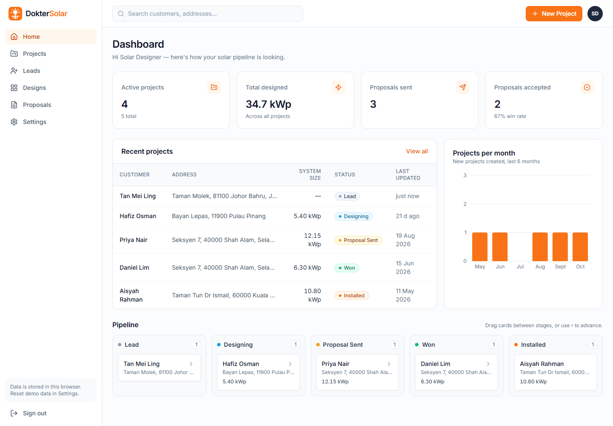
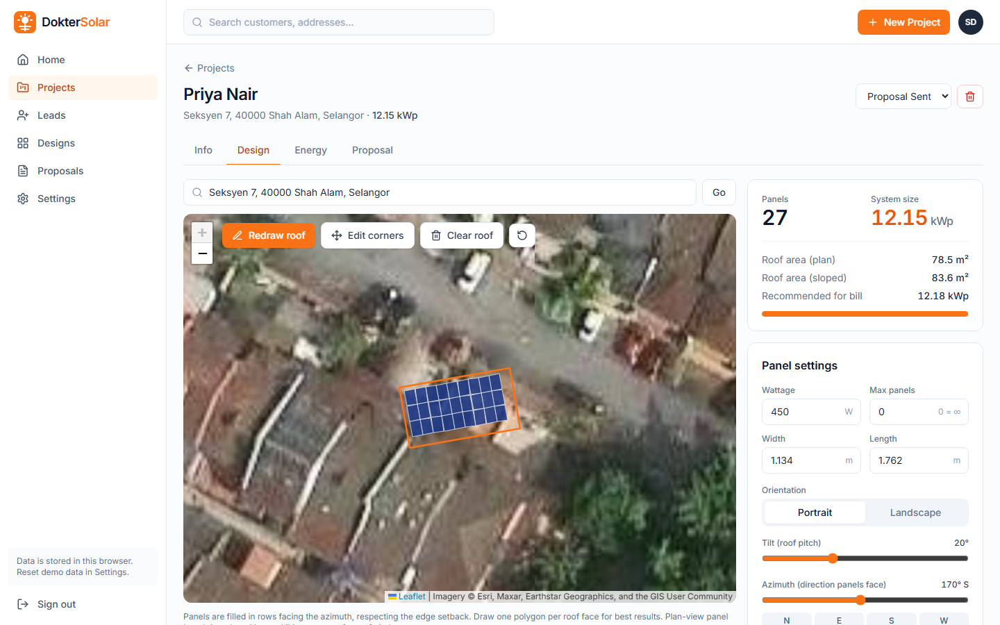
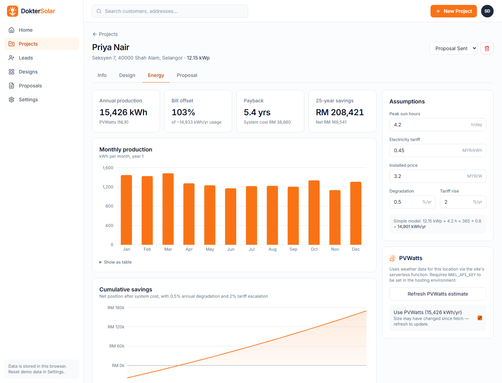
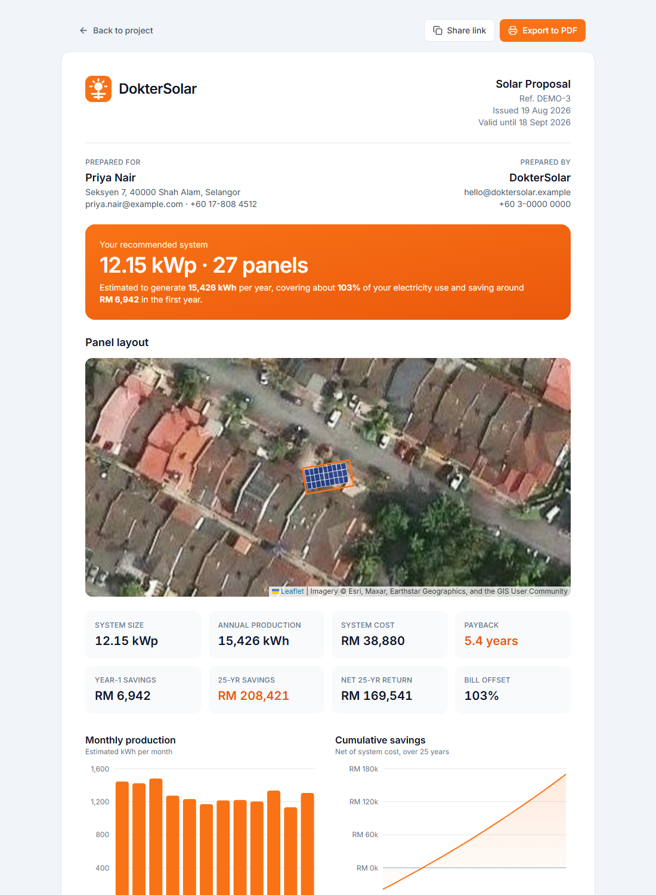
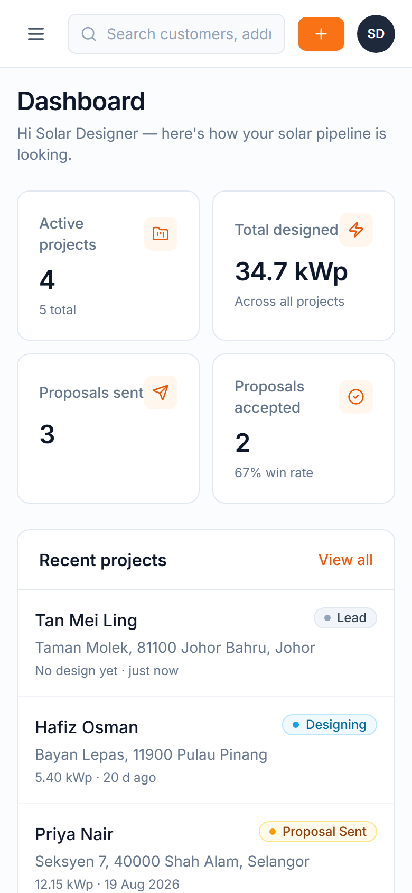

# DokterSolar ☀️

A solar design and proposal studio: sketch a roof on satellite imagery, auto-fill it with panels, estimate energy and savings, and send a printable customer proposal.

[](https://github.com/norazamkamisan/doktersolar/actions/workflows/build.yml)

**🔗 Live demo: [doktersolar.vercel.app](https://doktersolar.vercel.app)**

> Portfolio project. All names, branding, copy and UI are original.



## Screenshots

**Design tool**: draw the roof on satellite imagery and panels fill it automatically. Panel count and system size update live as you change the settings.



**Energy & savings**: monthly production, payback, 25-year savings and editable assumptions. Shown here with real weather-based figures from PVWatts (NLR) for Shah Alam.



<table>
  <tr>
    <td width="70%" valign="top">
      <strong>Customer proposal</strong>: printable and shareable, with a map snapshot, key numbers and charts.<br><br>
      
    </td>
    <td width="30%" valign="top">
      <strong>Mobile</strong>: fully responsive.<br><br>
      
    </td>
  </tr>
</table>

**Stack:** React 18 · Vite · TypeScript · Tailwind CSS · React Router · Leaflet (react-leaflet) with Esri World Imagery · Recharts · localStorage · Vercel (+ an optional serverless function for NREL PVWatts). Netlify config is included too.

---

## Features

| Area | What it does |
| --- | --- |
| **Dashboard** (`/home`) | Stat cards (active projects, kWp designed, proposals sent/accepted), recent projects, projects-per-month chart, drag-and-drop pipeline (Lead → Designing → Proposal Sent → Won → Installed) |
| **Projects** (`/projects`, `/projects/:id/:tab`) | Create projects (address geocoded with Nominatim), search/filter, tabs for Info, Design, Energy, Proposal |
| **Design tool** | Satellite map, click to draw the roof polygon (double-click or **Finish** to close), drag corners to edit, panels auto-filled in a grid with edge setback and gap. Wattage, size, orientation, tilt, azimuth and max panels are editable, with a live panel count and kWp |
| **Energy & savings** | `kWp × peak sun hours × 365 × 0.8`, or NREL PVWatts if configured. Monthly production chart, tariff, price per watt, degradation, tariff escalation, payback and 25-year cumulative savings |
| **Proposal** (`/proposals/:id`) | Clean customer-facing page with map snapshot, key numbers, charts and assumptions. **Export to PDF** uses the browser print dialog with print CSS. **Share link** puts the proposal data in the URL so it opens on any device |
| **Leads / Designs / Proposals** | Focused list views |
| **Settings** | Company name, contact, logo upload (stored as base64), default panel wattage, price per watt, tariff, peak sun hours and currency. You can also reset to the demo data |

Five sample projects in Malaysia are seeded on first load. Default currency is **MYR (RM)**; you can change it in Settings.

---

## Project structure

```
doktersolar/
├─ vercel.json                  # Vercel build + SPA rewrite
├─ api/pvwatts.js               # Vercel Function → /api/pvwatts
├─ server/pvwatts-core.mjs      # shared NREL PVWatts proxy logic (key stays server-side)
├─ netlify.toml                 # Netlify build + /api and SPA redirects (alternative host)
├─ netlify/functions/pvwatts.mjs  # Netlify Function wrapper around the same core
├─ docs/screenshots/            # README images
├─ public/favicon.svg
├─ index.html
├─ src/
│  ├─ main.tsx, App.tsx, index.css, types.ts
│  ├─ lib/
│  │  ├─ solar.ts      # roof geometry, panel layout, energy + financial model
│  │  ├─ store.ts      # localStorage-backed store + React hooks
│  │  ├─ defaults.ts   # default settings / design / energy
│  │  ├─ seed.ts       # 5 demo projects
│  │  ├─ api.ts        # Nominatim geocoding, PVWatts client, share-link encoding
│  │  └─ format.ts     # currency / number / date helpers
│  ├─ components/      # Layout, SolarMap, Charts, Pipeline, ProposalDocument, ui…
│  └─ pages/           # Home, Projects, ProjectDetail (+ project/ tabs), Leads, Designs, Proposals, ProposalView, Settings
└─ README.md
```

---

## Run locally

You need **Node.js 18+** (20 LTS recommended).

```bash
npm install
```

```bash
npm run dev
```

Open http://localhost:5173. Other scripts:

```bash
npm run build
```

```bash
npm run preview
```

```bash
npm run typecheck
```

### Running the PVWatts function locally (optional)

`npm run dev` runs the frontend only, so the **Get PVWatts estimate** button shows "function not available". To run the function too, use the Vercel CLI:

```bash
npm install -g vercel
```

Create a `.env` file (copy `.env.example`) containing `NREL_API_KEY=your-key`, then:

```bash
vercel dev
```

This serves the app and `/api/pvwatts` together (usually at http://localhost:3000).

Get a free API key at https://developer.nlr.gov/signup/. NREL is now the **National Laboratory of the Rockies (NLR)**, and its API moved from `developer.nrel.gov` to `developer.nlr.gov`. The environment variable keeps its original name, `NREL_API_KEY`.

---

## Deploy to Vercel (step by step)

1. **Push the project to GitHub** (or GitLab/Bitbucket).
2. Sign in at **https://vercel.com** (signing in with GitHub is easiest).
3. Click **Add New… → Project**, find the repo under **Import Git Repository**, and click **Import**.
4. Vercel reads `vercel.json`, so the settings fill in on their own:
   - Framework preset: **Vite**
   - Build command: `npm run build`
   - Output directory: `dist`
5. **(Optional) Turn on PVWatts now:** open **Environment Variables** on the same screen and add `NREL_API_KEY` = your NREL key.
6. Click **Deploy**. After a minute you get a URL like `https://doktersolar.vercel.app`.
   - The rewrite in `vercel.json` sends every non-`/api` path to `index.html`, so deep links such as `/projects/demo-1/design` and shared proposal links work.
   - `api/pvwatts.js` deploys automatically as a function at `/api/pvwatts`.
7. Every push to `main` redeploys. Pushes to other branches get their own preview URLs.

**Adding the key later:** go to **Project → Settings → Environment Variables**, add `NREL_API_KEY` (for Production, plus Preview if you want it there too), then **Deployments → ⋯ → Redeploy**. Environment variables only apply to new deployments.

The key is only read on the server (`server/pvwatts-core.mjs`, via `process.env.NREL_API_KEY`). It is never bundled into the frontend. Don't prefix it with `VITE_`.

**Alternative (CLI deploy):**

```bash
vercel --prod
```

### Deploying to Netlify instead

`netlify.toml` is kept, so Netlify works with no changes. Import the repo in Netlify; the build settings and the `/api/* → /.netlify/functions/*` redirect come from the file. Set `NREL_API_KEY` under **Site configuration → Environment variables**.

---

## How the numbers work

- **Roof area:** the polygon is projected to local metres (equirectangular around its centroid), then the shoelace formula gives the area. Sloped area = plan area ÷ cos(tilt).
- **Panel fill:** the roof is rotated so rows run perpendicular to the azimuth. A grid of panel footprints is tested: all four corners must sit inside the roof, at least the setback distance from every edge, and no roof vertex may poke into a panel. The plan-view length of a panel shrinks by cos(tilt). Sixteen grid offsets are tried and the one that fits the most panels wins.
- **Production (simple):** `kWp × peak sun hours × 365 × 0.8`, split across months by day count with a mild seasonal curve that grows with latitude.
- **Production (PVWatts):** PVWatts v8 from NLR (formerly NREL), fixed roof mount, 14% losses. The function tries the `nsrdb` dataset first and falls back to `intl`.
- **Savings:** year-*n* savings = production × (1 − degradation)^(n−1) × tariff × (1 + escalation)^(n−1). Payback is the interpolated year where cumulative savings exceed the system cost (`kWp × 1000 × price per watt`).

These are indicative estimates for a portfolio demo, not engineering-grade simulations. They don't model shading, inverter clipping, export tariffs or net metering.

---

## Notes & limitations

- **Storage:** all data lives in `localStorage` in your browser. Clearing site data, or using another browser, gives a fresh demo. Use **Settings → Reset demo data** to start over.
- **Share links** embed the proposal as base64 JSON in the URL fragment (`#d=…`). The fragment is never sent to the server. The uploaded logo is left out to keep links short.
- **Nominatim** is a free, rate-limited service (about 1 request per second). Geocoding runs only when you create a project or press **Locate/Go**.
- **Imagery:** Esri World Imagery tiles. Keep the on-map attribution. Check Esri's terms before any commercial use.
- **Sample roofs** are approximate rectangles placed near real coordinates for demo purposes.

## License

MIT for the code in this repository.
